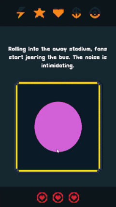
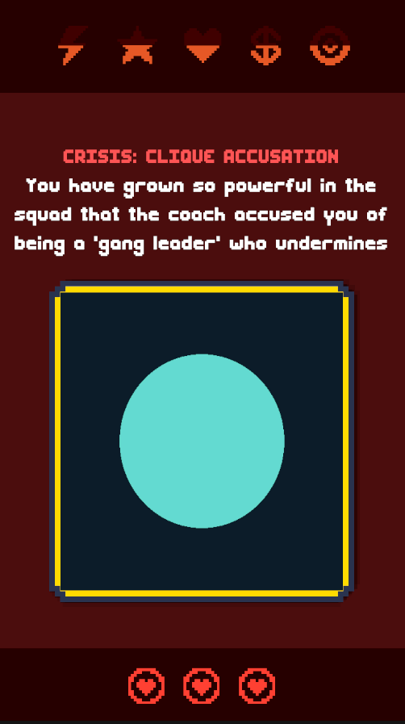
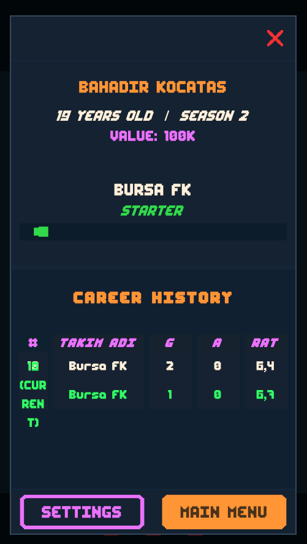
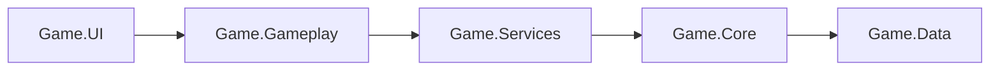

<h1>Journey</h1>

<b>A card-swiping football career game in the style of Reigns.</b> 
Live a footballer's whole career, one decision at a time.

---

## How it plays

Every card is a moment from a player's life: the coach, the agent, the press, the dressing room. Swipe left or right to choose. Each choice moves five resources, and pushing any of them to zero or to the maximum starts a crisis. Seasons run week by week, through transfers between clubs and Champions League nights, until the career comes to an end.

| ⚡ Form | 💰 Money | ⭐ Fame | ❤️ Relations | 🎯 Focus |
|:---:|:---:|:---:|:---:|:---:|

## At a glance

| 1,513 | 40 | 16 | 2 |
|:---:|:---:|:---:|:---:|
| cards, 481 of them for the Champions League | clubs in 6 countries | crisis events | languages, English and Turkish |

## Architecture

The code is organised in layers with one-way dependencies: a layer may use the layers below it, never the ones above.

| Decision | Why |
|---|---|
| `GameStateMachine` with a `GameState` enum | One source of truth for the game flow instead of scattered boolean flags |
| Central `GameEvents` bus | All in-game communication goes through one place |
| `GameConstants` | Keys and constants live in one place instead of magic strings |
| Content in JSON, read with Newtonsoft.Json | Cards, clubs, crises and endings are data. Card categories are strings, so new ones can be added without code changes |
| `Singleton<T>` and `PersistentSingleton<T>` | Every manager follows the same lifecycle |

> **Status:** The project is in the middle of a planned refactor toward this architecture. The data and service layers are done and the gameplay layer is in progress.

## Running the project

Open the folder with **Unity 2022.3.62f2** and open `Assets/Scenes/SampleScene.unity`.
